<div align="center">


<br/>

<a href="https://www.linkedin.com/in/caio-soares1/"></a>


</div>

---

```console
caio@dev:~$ whoami
  name       Caio Soares
  role       Full-Stack Software Developer
  education  Graduate in Internet Systems @ IFPB
  focus      Web applications, APIs and clean, maintainable code
  status     Open to new opportunities
  motto      "just chilling, i like to code :D"

caio@dev:~$ cat about.txt
  I'm a software developer who enjoys turning ideas into reliable,
  well-crafted products. I work across the stack, from responsive
  front-ends to robust back-end services, and I'm always exploring
  new tools and better ways to build.

caio@dev:~$ _
```

---

### `> ls ./tech-stack`

<p align="center">
  
</p>

---

### `> ls ./projects --featured`

<table>
<tr>
<td width="33%" valign="top">

#### <samp>01 · <a href="https://github.com/caiosoares1/westminster-songs">westminster-songs</a></samp>

<samp>Mobile app to create, browse and import song lyrics with chords, featuring OCR import and chord transposition.</samp>


</td>
<td width="33%" valign="top">

#### <samp>02 · <a href="https://github.com/caiosoares1/vetorcore">vetorcore</a></samp>

<samp>Progressive web app for sales and inventory management, with PDF quotes, row-level security and automated CI.</samp>


</td>
<td width="33%" valign="top">

#### <samp>03 · <a href="https://github.com/caiosoares1/claude-usage-tray">claude-usage-tray</a></samp>

<samp>Windows tray app that tracks usage limits across multiple Claude accounts and switches the active Claude Code account in one click.</samp>


</td>
</tr>
</table>

---

### `> cat ./stats.log`

<div align="center">





</div>

---

### `> ./snake --eat-contributions`

<p align="center">
  
</p>

---

<div align="center">

```
[ SYSTEM ONLINE ] — thanks for stopping by. let's build something.
```

</div>
